  

  <strong>KanoCifer</strong>

  <picture>
    <source media="(prefers-color-scheme: dark)" srcset="https://readme-typing-svg.demolab.com?font=Fira+Code&weight=600&size=26&pause=1600&color=8B949E&center=true&width=640&height=52&lines=Building+kanocifer.chat;nomu.kanocifer.chat;Python+/+Go+/+TypeScript&repeat=true">
    <source media="(prefers-color-scheme: light)" srcset="https://readme-typing-svg.demolab.com?font=Fira+Code&weight=600&size=26&pause=1600&color=57606A&center=true&width=640&height=52&lines=Building+kanocifer.chat;nomu.kanocifer.chat;Python+/+Go+/+TypeScript&repeat=true">
    
  </picture>

  LiuDeTao · A quiet builder · 静かに、確かに

  <a href="https://kanocifer.chat">Kanocifer.chat</a>
  &ensp;·&ensp;
  <a href="https://nomu.kanocifer.chat">Nomu</a>
  &ensp;·&ensp;
  <a href="https://github.com/KanoCifer?tab=following">Following</a>

 

---

## 🛠️ What I'm Building

<table>
  <tr>
    <td width="50%" valign="top">
      <h3><a href="https://kanocifer.chat">kanocifer.chat</a></h3>
      
我的主力产品，我的个人网站。

      
<code>Vue</code> <code>React</code> <code>Python</code> <code>Go</code>

    </td>
    <td width="50%" valign="top">
        <h3><a href="https://nomu.kanocifer.chat">Nomu</a></h3>
      
Chrome浏览器插件

      
<code>Go</code> <code>React</code>

    </td>
  </tr>
  <tr>
    <td width="50%" valign="top">
      <h3><a href="https://github.com/KanoCifer/DevTaskMcp">DevTaskMcp</a></h3>
      
Agent 原生的开发任务看板，把需求调研成可验收的任务，端到端执行。

      
<code>Python</code> <code>MCP</code> <code>Claude Code</code>

    </td>
    <td width="50%" valign="top">
      <h3><a href="https://github.com/KanoCifer/fishing">渔碌yulu</a></h3>
      
路亚，台钓，记录钓点和天气数据，提供垂钓建议

      
<code>Go</code> <code>uniapp</code> <code>wx</code>

    </td>
  </tr>
</table>

## 🧰 Stack

  
    
  
    
  

## 📊 Stats

  <picture>
    <source media="(prefers-color-scheme: dark)" srcset="./profile/stats-dark.svg">
    <source media="(prefers-color-scheme: light)" srcset="./profile/stats-light.svg">
    
  </picture>
  <picture>
    <source media="(prefers-color-scheme: dark)" srcset="./profile/top-langs-dark.svg">
    <source media="(prefers-color-scheme: light)" srcset="./profile/top-langs-light.svg">
    
  </picture>

  <picture>
    <source media="(prefers-color-scheme: dark)" srcset="https://streak-stats.demolab.com?user=KanoCifer&theme=dark&hide_border=true&background=00000000">
    <source media="(prefers-color-scheme: light)" srcset="https://streak-stats.demolab.com?user=KanoCifer&hide_border=true&background=00000000">
    
  </picture>

<!--
  ⚠️ 依赖清单（都已实测可用，但都是第三方公共实例）：
    - stats / top-langs → 本地 SVG，由 .github/workflows/grs.yml 用自己的 PAT 生成
      （classic token，scope = repo + read:user，所以统计包含私有仓库）
    - typing header / skill icons / streak → 远程公共实例，可能哪天就挂了

  已确认挂掉、不要再用的：
    - github-readme-activity-graph.vercel.app → Vercel 部署被暂停（"Deployment Paused"）
    - github-readme-stats.anuraghazra1.vercel.app → 官方仓库已停止维护
    - github-readme-streak-stats.herokuapp.com → Heroku 免费层停用，域名已废弃
    - DenverCoder1/github-profile-trophy → 仓库已 404

  如果哪天这里又裂图了，优先考虑把远程卡片也搬进自己的 Actions 生成。
-->
